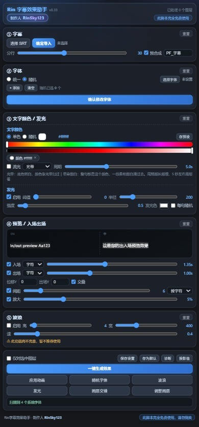
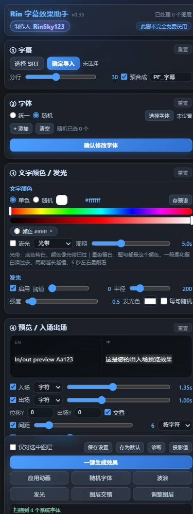
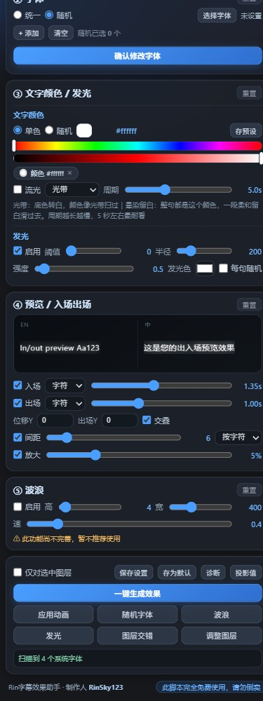

<div align="center">

# Rin字幕效果助手

**After Effects 字幕动画 CEP 面板 · 完全免费 · 开源**

[](https://www.gnu.org/licenses/gpl-3.0)
[](#环境要求)
[](#环境要求)
[](CHANGELOG.md)

by **RinSky123**

</div>

---

## 这是什么

一个从零实现的 After Effects **CEP 面板扩展**，用来批量做字幕卡点 / 逐字动画 / 发光流光。

导入一份 SRT，它会按时间码批量生成文字图层，然后一键套用字体、颜色、出入场动画、流光、发光。

**免授权、免联网、无加壳、无外部依赖**，装好即用。

## 效果预览



> 逐字擦除入场、发光、自动投影、持续缓慢放大 —— 全部由面板一键生成，不需要手动 K 帧。

## 界面


<details>
<summary><b>点击展开面板大图（上半部分 / 下半部分）</b></summary>

**上半部分** —— ① 字幕导入 ② 字体 ③ 文字颜色 · 发光 · 流光 ④ 实时预览



**下半部分** —— ④ 入场出场设置 ⑤ 波浪 与执行按钮



</details>

## 功能

| 模块 | 说明 |
|---|---|
| **SRT 导入** | 读取 `.srt`，按时间码批量生成文字图层（每条字幕一个图层，自动裁剪入/出点），可选自动预合成 |
| **句 / 词 / 字符 动画** | 用 AE 原生 **Text Animator + Range Selector** 实现，默认字符级「从左到右逐字擦除」，时长以秒为单位 |
| **出入场时长自适应** | 4 个词以上按你设的秒数；短句自动加快（3 词 ×0.78 / 2 词 ×0.62 / 1 词 ×0.48），保证动画完整走完 |
| **出场渐隐** | 出场时整层一起淡出，给下一条让路 |
| **新旧交叠** | 旧字幕开始渐隐的那一刻，新字幕正好开始入场 |
| **持续放大** | 从出现到消失整段缓缓放大（默认 +5%） |
| **文字颜色** | 单色，或**每条字幕一个颜色、相邻不重复**（洗牌轮转）。条形横杠直接取色，可存预设 |
| **流光** | 让颜色在文字上像水一样流动，两种模式：**光带**（颜色扫过）/ **晕染留白**（整句上色、一段留白滑过）。有开关、模式、周期（秒） |
| **发光** | 优先调用 **Deep Glow 2**（需自行安装），未安装时自动退回 AE 自带 Glow；发光色可单独设置，支持每句随机 |
| **自动投影** | 加发光时自动补一层 Drop Shadow，排在发光之后渲染，不会被糊住 |
| **字体** | 扫描系统已安装字体（解析二进制取 PostScript 名）；**每条字幕一个字体、相邻不重复** |
| **实时预览** | ④ 上方是**左英右中双列**预览，两句交替接替演示出入场；字体 / 颜色 / 发光 / 投影 / 波浪 / 流光全部实时反映 |
| **字符间距** | 用 Tracking Amount 动画器调节字/词间距 |
| **智能分行** | 超过「分行基准」字数自动折行（中文按字断、西文优先在空格断） |
| **附加** | 图层交错（卡点错开入点）、调整图层、诊断按钮 |

> **波浪**功能已接入 AE 的 Wave Warp，但效果尚不完善，面板上标注了「暂不推荐使用」。

## 环境要求

- **After Effects 2022 及以上**（CEF/CEP 11+）
- Windows 或 macOS
- 无需 Node.js、无需联网

## 安装

1. 下载 [最新 Release](../../releases/latest) 里的 zip，解压得到 `RinSubtitleHelper` 文件夹；
2. 把它复制到：
   - **Windows**：`C:\Program Files\Common Files\Adobe\CEP\extensions\`（**需要管理员权限**，复制时会弹 UAC）
   - **macOS**：`~/Library/Application Support/Adobe/CEP/extensions/`
3. 开启调试模式（未签名扩展必须开，否则菜单里看不到）：

   **Windows** — 给下面每个版本各建一个字符串值 `PlayerDebugMode = 1`：
   ```
   HKEY_CURRENT_USER\Software\Adobe\CSXS.11
   HKEY_CURRENT_USER\Software\Adobe\CSXS.12
   HKEY_CURRENT_USER\Software\Adobe\CSXS.13
   HKEY_CURRENT_USER\Software\Adobe\CSXS.14
   ```

   **macOS** — 终端执行：
   ```bash
   defaults write com.adobe.CSXS.11 PlayerDebugMode 1
   defaults write com.adobe.CSXS.12 PlayerDebugMode 1
   defaults write com.adobe.CSXS.13 PlayerDebugMode 1
   defaults write com.adobe.CSXS.14 PlayerDebugMode 1
   ```
4. **完全退出并重启 After Effects**（必须重启）；
5. 菜单：`窗口 (Window) → 扩展 (Extensions) → Rin字幕效果助手`。

## 使用

1. 打开一个合成；
2. **① 字幕**：点 **选择 SRT** → 设置分行基准 / 预合成 → 点 **确定导入**。
   导入只做两件事：按时间码建文字图层 + 预合成，**不施加任何效果**；
3. **②③④⑤** 调字体 / 颜色·发光·流光 / 入场出场 / 波浪，④ 上方实时预览；
4. 点 **一键生成效果**，对当前合成里的文字图层统一套用全部设置。

勾选 **仅对选中图层** 时，只作用在时间线里选中的文字图层上。

### 关于字体

导入字幕时**不会**套用 ② 里的字体。字体统一由 **② → 确认修改字体** 来应用，
这样你可以先导入、调好动画，最后再决定字体。

## 项目结构

```
rin-subtitle-helper/
├── RinSubtitleHelper/          ← 扩展本体（复制这个文件夹即可安装，zip 也是它）
│   ├── README.md               完整文档（随扩展一起分发）
│   ├── CSXS/manifest.xml       扩展清单（ID、版本、AE 版本范围）
│   ├── client/                 面板（HTML + CSS + JS，跑在 CEF 里）
│   │   ├── index.html
│   │   ├── index.js            面板逻辑：读写 UI、组装参数、调宿主
│   │   ├── style.css
│   │   ├── CSInterface.js      精简版 CEP 接口
│   │   └── fonts.js            Node 侧字体扫描（可选后备）
│   └── host/engine.jsx         引擎：全部 AE 逻辑，纯 ExtendScript
├── docs/images/                README 用的截图
├── tools/
│   ├── install.ps1             一键安装
│   └── pack.ps1                打包发布 zip
├── CHANGELOG.md
└── LICENSE
```

## 实现原理

- **面板** `client/`：HTML + CSS + JS，用 CEP 的 `evalScript` 把参数以 JSON 发给宿主。
- **引擎** `host/engine.jsx`：全部 AE 逻辑，纯 ExtendScript（ES3）。关键对应关系：

  | 效果 | 实现 |
  |---|---|
  | 文字动画 | `ADBE Text Animator` + `ADBE Text Selector`，入场推 `Percent Start` 0→100，出场推 `Percent End` 0→100 |
  | 粒度 | `ADBE Text Range Type2` = 1(字符) / 3(词)；「句」直接对图层做透明度关键帧 |
  | 流光 | Text Animator 的 `ADBE Text Fill Color` + Selector `Percent Offset`，周期用**表达式**驱动连续来回波 |
  | 波浪 | 效果 `ADBE Wave Warp` |
  | 发光 | `PEDG`（Deep Glow 2），退回 `ADBE Glo2` |
  | 投影 | 效果 `ADBE Drop Shadow`，按属性名扫描赋值（中英文都能认） |

- **调用约定**：面板发 `PF_xxx({...})`，宿主端直接拿到对象（JSON 是 ES3 对象字面量子集）。

## 开发

改完代码后：

```powershell
# 打包一个可发布的 zip（版本号从 manifest 自动读）
powershell -ExecutionPolicy Bypass -File tools\pack.ps1
```

调试时建议：

- 改面板代码 → 直接重开面板即可（`窗口 → 扩展`）；
- 改 `host/engine.jsx` → 也要重开面板（面板启动时会重新加载引擎）；
- 引擎报错会直接显示在面板底部状态栏，带行号。

## 已知问题

- **波浪**效果不完善，面板上已标注，暂不推荐使用；
- **流光**依赖 AE 的 Text Animator，个别 AE 版本/语言下若选择器属性名不同，可能出现不流动；
  面板底部有 **诊断** 按钮可以打印实际状态；
- **发光颜色**：Deep Glow 2 的参数名在其二进制里是加密的，本项目按关键字（阈值/半径/曝光/color）匹配写入。
  如果你的 Deep Glow 版本命名不同，发光色可能不生效。

## 常见问题

**`窗口 → 扩展` 里看不到？**
多半是没开 `PlayerDebugMode`，或 AE 没完全重启（任务管理器里不能有 `AfterFX.exe`）。

**字幕是乱码？**
引擎按 UTF-8 读取；若 SRT 是 GBK，用记事本另存为 UTF-8 即可。

**流光看起来没在动？**
周期滑杆调小一点；流光在文字颜色不是纯白时最明显。

## 许可

本项目基于 **GNU General Public License v3.0** 发布，见 [LICENSE](LICENSE)。

这意味着你可以自由使用、修改、分发，但**基于它的衍生作品也必须以 GPL-3.0 开源**。

**此脚本完全免费使用，请勿倒卖。**

不包含任何第三方商业插件（发光依赖的 Deep Glow 2 需自行购买，未安装时会自动退回 AE 自带 Glow）。

## 致谢

- 面板 UI 与 AE 交互逻辑全部原创实现
- `client/CSInterface.js` 是按 CEP 官方接口重写的精简版，未使用 Adobe 原始代码
