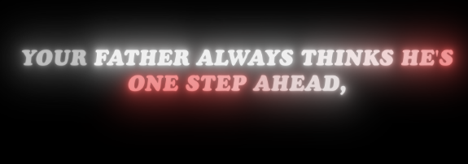
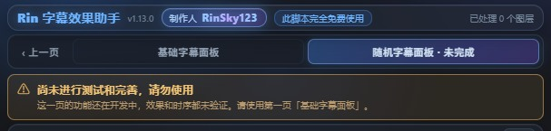

<div align="center">

# Rin字幕效果助手

**After Effects 字幕动画 CEP 面板 · 完全免费 · 开源**

[](https://www.gnu.org/licenses/gpl-3.0)
[](#环境要求)
[](#环境要求)
[](CHANGELOG.md)

by **RinSky123**

</div>

---

## 这是什么

一个从零实现的 After Effects **CEP 面板扩展**，用来批量做字幕卡点 / 逐字动画 / 发光流光。

导入一份 SRT，它会按时间码批量生成文字图层，然后一键套用字体、颜色、出入场动画、流光、发光。

**免授权、免联网、无加壳、无外部依赖**，装好即用。

> ⚠️ **当前版本 v1.13.1 属于开发中版本。**
> 第一页「基础字幕面板」已经可用；**第二页「随机字幕面板」尚未测试完善，请勿使用**。
> 详见下方 [版本状态](#版本状态)。

## 效果预览



> 逐字擦除入场、发光、自动投影、持续缓慢放大 —— 全部由面板一键生成，不需要手动 K 帧。

## 界面


<details>
<summary><b>点击展开面板大图（上半部分 / 下半部分）</b></summary>

面板顶部是**页签栏**（基础字幕面板 / 随机字幕面板），下面按两列网格自动排：

**第一行** —— ① 字幕导入 + ② 字体
**第二行** —— ③ 文字颜色 · 流光 + ③ 发光（同一行两张卡自动等高，四角对齐）
**第三行** —— ④ 动画预览 · 入场出场（通栏）
**第四行** —— ⑤ 波浪（通栏）；底部是**执行区**（保存设置 / 诊断 / 一键生成效果等）


</details>

## 功能

| 模块 | 说明 |
|---|---|
| **SRT 导入** | 读取 `.srt`，按时间码批量生成文字图层（每条字幕一个图层，自动裁剪入/出点），可选自动预合成。**每条自动延长 N 帧**（默认 50），可开关强制大写 / 清洗标点 |
| **句 / 词 / 字符 动画** | 用 AE 原生 **Text Animator + Range Selector** 实现，默认字符级「从左到右逐字擦除」 |
| **出入场按帧调节** | 入场基准 **1.5 秒**（±60 帧）、出场基准 **35 帧**（10~50 帧）。滑块是帧偏移，**卡点不会因帧率漂移**；面板实时显示换算结果 |
| **出出场渐隐（强制）** | **任何入场都渐显、任何出场都渐隐**，整层透明度与逐字动画同一时间窗口。两条字幕交叠时新的那条不会被糊住 |
| **出场时间轴** | 从**原 SRT 出点**开始匀速淡出，淡完正好到出点。延长段不会再出现"全亮空转" |
| **新旧交叠** | 旧字幕开始渐隐的那一刻，新字幕正好开始入场 |
| **持续放大** | 从入场开始一直放大到出场结束，字间距同步缓缓拉开（默认面板值 6 ≈ 实际 +10%）。**只要有动画就自动生效** |
| **文字颜色** | 单色，或**每条字幕一个颜色、相邻不重复**（洗牌轮转）。条形横杠直接取色，可存预设 |
| **流光** | 让颜色在文字上像水一样流动，四种模式：**光带**（白底、彩色光带扫过）/ **晕染留白**（整句上色、一大块留白滑过）/ **全范围晕染留白**（3~6 处留白同时扫过）/ **彩带**（斜向条带染色）。**全部用分形噪波实现，多行字幕同时染色**。有开关、模式、周期、留白处数 |
| **发光** | 优先调用 **Deep Glow 2**（需自行安装，**中英文版都能写参数**），未安装时自动退回 AE 自带 Glow；半径 / 曝光 / 灯光强度可调，发光色有一套和文字颜色同款的调色区。**文字是白色时用发光色设置，文字是其它颜色时发光自动跟随文字颜色** |
| **双层投影（强制）** | **只要做了发光，两层投影必然存在**：**发光前**（100% / 135° / 距离5 / 柔和2）+ **发光后**（90% / 135° / 距离5 / 柔和20）。顺序固定为 `投影1 → 发光 → 投影2` |
| **字体** | 扫描系统已安装字体（解析二进制取 PostScript 名）；**每条字幕一个字体、相邻不重复** |
| **实时预览** | 动画预览（④）演示出入场 + 颜色 + 流光（逐字推进、5 秒无缝循环）；发光预览（③）演示发光 + 双层投影。都是**左英右中双列**，实时反映、不卡顿 |
| **字符间距** | 用 Tracking Amount 动画器调节字/词间距 |
| **智能分行** | 超过「分行基准」字数自动折行。**绝不拆单词**（能放进下一行就整体挪走）、**标点不单独成行**、行首不留收尾标点、行尾不留开引号 |
| **精确数值** | 所有滑杆旁边都能直接输入数字，回车即生效 |
| **诊断工具** | 「诊断」查动画器、「时序」查标记/出点/淡出区间、「投影值」查效果链、「发光值」查 Deep Glow 实际参数名 |
| **附加** | 图层交错（卡点错开入点）、调整图层、参数预设、恢复出厂 |

> **波浪**功能已接入 AE 的 Wave Warp，但效果尚不完善，面板上标注了「暂不推荐使用」。

> ⚠️ **第二页「随机字幕面板」尚未测试和完善，请勿使用。**
> 面板里已标注，这里再说明一次：第二页的随机字体 / 随机颜色 / 随机动画 /
> 画面与文字等功能都还在开发中，效果和时序均未验证。请使用**第一页「基础字幕面板」**。

## 版本状态

| 页面 | 状态 | 说明 |
|---|---|---|
| **第一页 · 基础字幕面板** | ✅ 可用 | 导入、字体、颜色、流光、发光、出入场、波浪、双层投影都已完整可用 |
| **第二页 · 随机字幕面板** | ⚠️ **未完成** | 随机字体 / 随机颜色 / 随机动画 / 画面与文字 仍在开发，**请勿使用** |

第二页在面板里已加了醒目的提示条，页签也标记为「未完成」：



## 环境要求

- **After Effects 2022 及以上**（CEF/CEP 11+）
- Windows 或 macOS
- 无需 Node.js、无需联网

## 安装

1. 下载 [最新 Release](../../releases/latest) 里的 zip，解压得到 `RinSubtitleHelper` 文件夹；
2. 把它复制到：
   - **Windows**：`C:\Program Files\Common Files\Adobe\CEP\extensions\`（**需要管理员权限**，复制时会弹 UAC）
   - **macOS**：`~/Library/Application Support/Adobe/CEP/extensions/`
3. 开启调试模式（未签名扩展必须开，否则菜单里看不到）：

   **Windows** — 给下面每个版本各建一个字符串值 `PlayerDebugMode = 1`：
   ```
   HKEY_CURRENT_USER\Software\Adobe\CSXS.11
   HKEY_CURRENT_USER\Software\Adobe\CSXS.12
   HKEY_CURRENT_USER\Software\Adobe\CSXS.13
   HKEY_CURRENT_USER\Software\Adobe\CSXS.14
   ```

   **macOS** — 终端执行：
   ```bash
   defaults write com.adobe.CSXS.11 PlayerDebugMode 1
   defaults write com.adobe.CSXS.12 PlayerDebugMode 1
   defaults write com.adobe.CSXS.13 PlayerDebugMode 1
   defaults write com.adobe.CSXS.14 PlayerDebugMode 1
   ```
4. **完全退出并重启 After Effects**（必须重启）；
5. 菜单：`窗口 (Window) → 扩展 (Extensions) → Rin字幕效果助手`。

## 使用

1. 打开一个合成；
2. **① 字幕**：点 **选择 SRT** → 设置分行基准 / 延长帧数 / 预合成 → 点 **确定导入**。
   导入只做三件事：按时间码建文字图层、把出点延长 N 帧、可选预合成，**不施加任何效果**；
3. **②③④⑤** 调字体 / 颜色·发光·流光 / 入场出场 / 波浪，④ 上方实时预览；
4. 点 **一键生成效果**，对当前合成里的文字图层统一套用全部设置。

勾选 **仅对选中图层** 时，只作用在时间线里选中的文字图层上。

### 出入场按帧调

④ 里的入场 / 出场不再是秒数，而是**帧偏移**：

| | 基准 | 滑块范围 |
|---|---|---|
| 入场 | 1.5 秒 | −60 ~ +60 帧 |
| 出场 | 35 帧（25fps 下 1.4 秒） | −25 ~ +15 帧（结果 10~50 帧） |

滑块中间是 0，往左减帧、往右加帧，下面实时显示换算结果。用帧而不是秒，
是为了**卡点不随工程帧率漂移**。数值框可直接输入。

### 三件会自动做的事

以下不需要手动勾选，条件满足就必然生效：

1. **做了发光 → 双层投影**（发光前一后各一层）
2. **做了任何出入场动画 → 整层渐隐渐显**（让路给下一条字幕）
3. **做了任何动画 → 持续放大 + 字距拉开**

### 关于字体

导入字幕时**不会**套用 ② 里的字体。字体统一由 **② → 确认修改字体** 来应用，
这样你可以先导入、调好动画，最后再决定字体。

### 出场不对时怎么查

点执行区的 **时序** 按钮，会打印这条字幕的原始出点、延长量、出场帧数和淡出区间。
正常应该是：

```
标记:_rinsub_out:12.5|2|100,100 ‖ 原始出点:12.5s ‖ 出点:13.9s
‖ 出场基准:35 帧 = 1.4s ‖ 淡出区间:12.5s ~ 13.9s
```

**出点应该正好等于淡出区间的终点。** 如果出点更大，说明字幕会全亮空转。

## 项目结构

```
rin-subtitle-helper/
├── RinSubtitleHelper/          ← 扩展本体（复制这个文件夹即可安装，zip 也是它）
│   ├── README.md               完整文档（随扩展一起分发）
│   ├── CSXS/manifest.xml       扩展清单（ID、版本、AE 版本范围）
│   ├── client/                 面板（HTML + CSS + JS，跑在 CEF 里）
│   │   ├── index.html
│   │   ├── index.js            面板逻辑：读写 UI、组装参数、调宿主
│   │   ├── style.css
│   │   ├── CSInterface.js      精简版 CEP 接口
│   │   └── fonts.js            Node 侧字体扫描（可选后备）
│   └── host/engine.jsx         引擎：全部 AE 逻辑，纯 ExtendScript
├── docs/images/                README 用的截图
├── tools/
│   ├── install.ps1             一键安装
│   └── pack.ps1                打包发布 zip
├── CHANGELOG.md
└── LICENSE
```

## 实现原理

- **面板** `client/`：HTML + CSS + JS，用 CEP 的 `evalScript` 把参数以 JSON 发给宿主。
- **引擎** `host/engine.jsx`：全部 AE 逻辑，纯 ExtendScript（ES3）。关键对应关系：

  | 效果 | 实现 |
  |---|---|
  | 文字动画 | `ADBE Text Animator` + `ADBE Text Selector`，入场推 `Percent Start` 0→100，出场推 `Percent End` 0→100 |
  | 粒度 | `ADBE Text Range Type2` = 1(字符) / 3(词)；「句」走字符粒度 + 整层渐隐，实现"一行一行从左到右" |
  | 渐隐渐显 | 图层 `ADBE Opacity` 关键帧，与逐字动画同一时间窗口（强制，见 [CONVENTIONS.md](CONVENTIONS.md)） |
  | 流光 | Text Animator 的 `ADBE Text Fill Color` + Selector `Percent Offset`，周期用**表达式**驱动连续来回波 |
  | 波浪 | 效果 `ADBE Wave Warp` |
  | 发光 | `PEDG`（Deep Glow 2），退回 `ADBE Glo2` |
  | 投影 | 效果 `ADBE Drop Shadow`，按属性名扫描赋值（中英文都能认）；两层投影靠「清场后按顺序重加」保证 `投影1 → 发光 → 投影2` |
  | 出点记录 | 图层**标记组** `layer.marker.setValueAtTime()`（不是 `layer.marker = ...`，那是只读赋值会静默失败） |

- **调用约定**：面板发 `PF_xxx({...})`，宿主端直接拿到对象（JSON 是 ES3 对象字面量子集）。

## 开发

改完代码后：

```powershell
# 打包一个可发布的 zip（版本号从 manifest 自动读）
powershell -ExecutionPolicy Bypass -File tools\pack.ps1
```

调试时建议：

- 改面板代码 → 直接重开面板即可（`窗口 → 扩展`）；
- 改 `host/engine.jsx` → 也要重开面板（面板启动时会重新加载引擎）；
- 引擎报错会直接显示在面板底部状态栏，带行号。

## 已知问题

- **波浪**效果不完善，面板上已标注，暂不推荐使用；
- **流光**依赖 AE 的 Text Animator，个别 AE 版本/语言下若选择器属性名不同，可能出现不流动；
  面板底部有 **诊断** 按钮可以打印实际状态；
- **发光参数**：Deep Glow 2 的参数名在其二进制里是加密的，本项目按关键字匹配写入，
  **中英文都认**（汉化版的「半径 / 曝光 / 灯光强度」也能写进去）。
  万一遇到完全认不出的版本，点执行区的「**发光值**」按钮可以打印实际参数名。

## 常见问题

**`窗口 → 扩展` 里看不到？**
多半是没开 `PlayerDebugMode`，或 AE 没完全重启（任务管理器里不能有 `AfterFX.exe`）。

**字幕是乱码？**
引擎按 UTF-8 读取；若 SRT 是 GBK，用记事本另存为 UTF-8 即可。

**流光看起来没在动？**
周期滑杆调小一点；流光在文字颜色不是纯白时最明显。

**发光/投影看着没生效？**
点「**投影值**」按钮，状态栏会打印该图层**整条效果链的顺序**和两层投影的实际参数，
正常应该是 `投影1-发光前 > Deep Glow 2 > 投影2-发光后`。

**把参数调乱了想回到最初？**
点「**恢复出厂**」，所有参数回到默认（半径 200 / 曝光 0.32 / 灯光强度 0.4 等）。
自己「存为预设」的参数不受影响，可以随时再套用。

## 许可

本项目基于 **GNU General Public License v3.0** 发布，见 [LICENSE](LICENSE)。

这意味着你可以自由使用、修改、分发，但**基于它的衍生作品也必须以 GPL-3.0 开源**。

**此脚本完全免费使用，请勿倒卖。**

不包含任何第三方商业插件（发光依赖的 Deep Glow 2 需自行购买，未安装时会自动退回 AE 自带 Glow）。

## 致谢

- 面板 UI 与 AE 交互逻辑全部原创实现
- `client/CSInterface.js` 是按 CEP 官方接口重写的精简版，未使用 Adobe 原始代码
